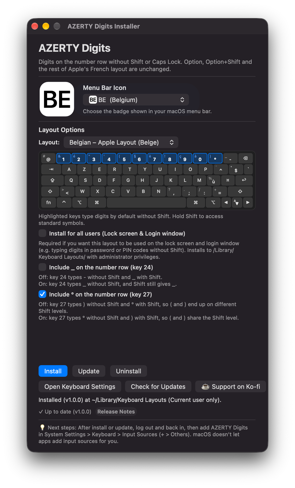

# AZERTY-Digits

<p align="center">
  <a href="https://github.com/kceryrk/AZERTY-Digits/releases/latest">
    
  </a>
  <a href="https://ko-fi.com/kaecr">
    
  </a>
  
</p>

<p align="center">
  <b>Direct access to digits on macOS AZERTY keyboards — without holding Shift.</b><br>
  <i>Accès direct aux chiffres sur clavier AZERTY pour Mac — sans maintenir la touche Majuscule.</i>
</p>

<p align="center">
  <a href="#english">English</a> • <a href="#français">Français</a> • <a href="#screenshots--preview">Screenshots & Preview</a> • <a href="#installation">Installation</a>
</p>

---

## Screenshots & Preview

<!-- Place your screenshots or demo GIFs in the ./media folder -->
<p align="center">
  
</p>

> [!TIP]
> **Add your media here:** Drop your screenshots and animated GIFs into the [`./media/`](./media) folder (e.g. `media/installer-preview.png`, `media/menubar-demo.gif`).

---

<a name="english"></a>
## English

**AZERTY-Digits** provides native macOS keyboard layouts with **direct access to numbers** on the top row, just like on Windows or PC keyboards. Designed especially for developers, accountants, students, and switchers who type numbers frequently without a numeric keypad.

### ✨ Features
- **Direct Numbers without Shift**: Type `1 2 3 4 5 6 7 8 9 0` directly. Hold `Shift` for symbols (`& é " ' § ( - ç è ) ! à`).
- **All Regional Variants**: Supports **France (FR)**, **Belgium (BE)**, **Luxembourg (LU)**, **Morocco (MA)**, **Algeria (DZ)**, and **French PC (FRPC)**.
- **Modern Apple-Native GUI Installer**: Visual keyboard preview, one-click installation, and automatic updates.
- **Lock Screen & Login Window Support**: Install system-wide (`/Library`) to type your password or PIN without holding Shift on startup.
- **Adaptive Menu Bar Icons**: Native pill badges matching macOS Dark and Light modes, with single-letter, 2-letter, and dark badge overrides.
- **Zero Background Resource Usage**: Generates a standard native macOS `.keylayout` — zero CPU or battery drain.

---

<a name="français"></a>
## Français

**AZERTY-Digits** est une disposition de clavier native pour macOS permettant un **accès direct aux chiffres** sur la rangée supérieure, sans avoir à maintenir la touche Majuscule (`Shift`), à la manière des claviers PC/Windows. Indispensable pour les développeurs, comptables, étudiants et utilisateurs de MacBook sans pavé numérique.

### ✨ Fonctionnalités
- **Chiffres directs sans Majuscule** : Tapez directement `1 2 3 4 5 6 7 8 9 0`. Maintenez `Shift` pour obtenir les caractères accentués et symboles (`& é " ' § ( - ç è ) ! à`).
- **Toutes les variantes régionales** : Prise en charge de **France (FR)**, **Belgique (BE)**, **Luxembourg (LU)**, **Maroc (MA)**, **Algérie (DZ)** et **Français PC (FRPC)**.
- **Installateur Graphique macOS** : Aperçu interactif du clavier en direct, installation et mise à jour en un clic.
- **Compatible Écran de Verrouillage & Ouverture de Session** : Installation pour tous les utilisateurs (`/Library`) pour saisir votre mot de passe ou code PIN sans Shift dès le démarrage.
- **Icônes Barre des Menus Dynamiques** : Badges élégants au format Apple adaptés au Mode Sombre et Mode Clair, avec options 1 lettre, 2 lettres ou badge sombre permanent.
- **100% Natif et Léger** : Utilise le format standard `.keylayout` d'Apple — aucun processus en arrière-plan, aucune consommation de batterie ou de mémoire.

---

<a name="installation"></a>
## Installation

### Option 1 : Application Graphique (Recommandé)
1. Téléchargez la dernière version : [**Télécharger AZERTY Digits (DMG)**](https://github.com/kceryrk/AZERTY-Digits/releases/latest).
2. Ouvrez le `.dmg` et lancez **AZERTY Digits Installer.app**.
3. Choisissez votre pays/variante et vos options d'icône, puis cliquez sur **Install**.
4. Activez la disposition dans :
   **Réglages Système** > **Clavier** > **Méthodes de saisie** > **Modifier...** > **+** > **Autres** > **AZERTY Digits**.

### Option 2 : Terminal / Script Shell
```bash
./src/install.sh install              # Installer pour l'utilisateur actuel (~/Library/Keyboard Layouts)
./src/install.sh install --all-users  # Installer pour tous les utilisateurs / Écran de verrouillage (/Library)
./src/install.sh update               # Mettre à jour la disposition
./src/install.sh uninstall            # Désinstaller
./src/install.sh status               # Vérifier l'état de l'installation
```

> [!NOTE]
> Après l'installation, fermez votre session ou redémarrez votre Mac si macOS n'affiche pas immédiatement la disposition dans la liste des méthodes de saisie.

---

## SEO & Keywords / Mots-clés
`macos azerty direct digits` • `clavier azerty mac chiffres sans shift` • `french azerty numbers without shift macos` • `belgian azerty mac numbers` • `clavier macbook chiffres directs` • `azerty chiffres direct mac` • `macOS keyboard layout direct numbers` • `chiffres accès direct mac azerty`
